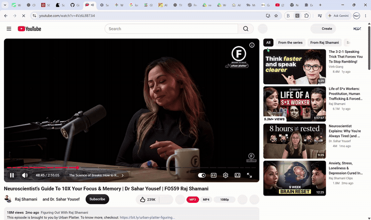

<p align="center"></p>

# Gugu Grab

**One-click MP3 / MP4 from YouTube — and 1800+ other sites. No account, no ads, no cloud, nothing uploaded.**

<p><sub>Built by <a href="https://github.com/mustavirafid-dev"><b>Mustavi Rafid</b></a> — idea, design and code. · <b>v1.0.1</b></sub></p>

Gugu Grab adds two buttons to every YouTube video and Short — `MP3` and `MP4`. Click one, the file is saved to a folder you pick. For everything else, paste a link into the toolbar popup and it goes through the same pipeline. The audio conversion, metadata tagging and cover-art embedding happen on your own machine.

It is a thin browser extension plus a small local helper that drives [yt-dlp](https://github.com/yt-dlp/yt-dlp) and `ffmpeg`. Nothing leaves your computer.



<p align="center"><sub><i>Buttons appear on the video page — a few seconds later the tagged file is on your disk.</i></sub></p>

```
YouTube page  ──►  extension  ──►  127.0.0.1:8765  ──►  yt-dlp + ffmpeg  ──►  your folder
                (button)          (local helper)        (download + convert)
```

---

## Why this exists

Most "YouTube downloader" extensions either want an account, show ads, upload your links to someone's server, or break the moment YouTube changes its markup.

| | Gugu Grab | Typical downloader site |
|---|---|---|
| Account required | no | usually |
| Ads | none | yes |
| Your URLs sent to a third party | never | always |
| Works on Shorts | yes | sometimes |
| Output quality | MP3 320 kbps, MP4 selectable up to 4K | capped or paid |
| Cost | free | freemium |

---

## Install (Windows 10/11 + Chrome or Edge)

**1. Run the setup**

Double-click `setup.bat`. It finds Python, installs `yt-dlp`, checks for `ffmpeg`, and optionally sets the helper to start with Windows.

**2. Pick a save folder**

A browser tab opens at `http://127.0.0.1:8765/setup`. Choose a folder (or type any path) and click **Save**.

**3. Load the extension**

`setup.bat` prints the path. Then:

- open `chrome://extensions`
- turn on **Developer mode** (top right)
- click **Load unpacked**
- select the `extension` folder inside this one

Open any YouTube video. The buttons appear next to Share. On Shorts they float on the left side.

---

## Usage

**On YouTube** — click `MP3` or `MP4`. The button shows `…` while working, `✓` when saved, `✕` on failure. A toast tells you the filename.

**Anywhere else** — click the Gugu Grab icon in the toolbar, paste a link, pick MP3 or MP4, hit **Grab**. The popup shows live progress. If the tab you are on already holds a single video, the link is filled in for you.

That second path works because the helper hands any `http(s)` URL straight to yt-dlp, which understands [1800+ sites](https://github.com/yt-dlp/yt-dlp/blob/master/supportedsites.md) — Facebook, Instagram, TikTok, Vimeo, SoundCloud, Dailymotion, X and so on. There is no per-site scraping anywhere in this project, so nothing breaks when a site redesigns its page.

**Video quality is selectable.** A dropdown sits next to the MP4 button: `Best available`, `2160p 4K`, `1440p`, `1080p`, `720p`, `480p`. It defaults to 1080p and remembers your choice. `Best available` grabs whatever the video actually offers, so a 4K upload gives you 4K.

Note that above 1080p YouTube only serves VP9 or AV1, so a 4K download is an `.mp4` containing VP9/AV1 rather than H.264. It plays fine in Chrome, VLC, mpv and modern editors, but older hardware players may not decode it.

Change the save folder any time: <http://127.0.0.1:8765/setup>

Files are named after the video title plus the video ID, so re-downloading the same video is detected and skipped rather than duplicated.

---

## Requirements

| | |
|---|---|
| OS | Windows 10 / 11 |
| Browser | Chrome, Edge, or any Chromium build (Manifest V3) |
| Python | 3.9+ — `setup.bat` finds an existing install or tells you what to get |
| ffmpeg | needed for MP3 conversion and cover art — `setup.bat` warns if missing |
| yt-dlp | installed automatically by `setup.bat` |

---

## How it works

A browser extension **cannot** download and convert audio by itself — there is no stream API and extensions cannot execute binaries. So the work is split:

- **`extension/`** — Manifest V3. Injects the buttons, sends the video URL to the helper, polls for progress, shows the toast. All network calls happen in the background worker, not the content script, so page CSP cannot block them.
- **`helper.py`** — a `ThreadingHTTPServer` on `127.0.0.1:8765`. Accepts jobs, runs `yt-dlp` in a thread, and detects the finished file by diffing a directory snapshot (never by parsing console output, which mangles non-ASCII filenames on Windows).
- **`setup.ps1` / `start-helper.bat` / `uninstall.bat`** — install, run, remove.

### Security model

- The helper binds to **loopback only**. Nothing on your network can reach it.
- `POST /download` accepts **only** `chrome-extension://` and `moz-extension://` origins — a random website cannot make your machine download something.
- `POST /config` additionally accepts the loopback setup page, so the folder picker works.
- Only one helper can hold the port; a second instance refuses and says so.

---

## Troubleshooting

**Buttons say "helper not running"** — the helper stopped. Run `start-helper.bat` and leave the window open.

**Buttons don't appear at all** — reload the extension at `chrome://extensions` (the card should read **1.0.1**), then hard-refresh the YouTube tab (Ctrl+Shift+R). Content scripts do not reinject into tabs that were already open.

**"This site is not supported"** — yt-dlp's extractor list is huge but not universal. The known gaps: **WeChat Channels (视频号)** and anything else that only exists inside a phone app, **DRM-protected** streaming services (Netflix, Disney+, Spotify), and sites that need your logged-in session. Gugu Grab deliberately never touches your accounts, so those cannot be fixed by a patch. For a video stuck in an app, `screen-recorder.bat` in this repo captures it instead.

**A download fails** — press F12 on the YouTube tab, open Console, and look for lines starting with `[Gugu]`. The helper window also prints a `SAVED` block for every success and the exact error for every failure. In the popup, hover the red message to see yt-dlp's original wording.

**The popup shows no percentage** — before the first byte arrives, yt-dlp spends a few seconds resolving the link, so the bar is indeterminate and the label reads `Reading the link… 4s`. The seconds keep climbing; that is proof it is alive. A real percentage appears once the transfer starts. If the label freezes at `Reading the link…` for minutes with no bytes on disk, the site is refusing the request (login wall, geo-block, DRM) — run `yt-dlp --simulate "<url>"` in a terminal to see the reason.

**"The helper was restarted — the job is gone"** — the helper process is new, so its in-memory job list is empty. The file may still have downloaded; check the save folder. Just grab again.

**Two `python.exe` processes in Task Manager** — normal on a virtualenv: the launcher `python.exe` starts the real interpreter as a child and waits. Only the child listens on 8765; there is no second helper.

**A long video takes ages** — this is mostly physics, not a bug. An MP4 download fetches the video stream and the audio stream separately, then merges them, so it is two transfers plus a remux. A two-hour 4K video is 5–10 GB; on a 15 Mbps line that is 45 minutes no matter what tool you use. The button shows a live percentage — if it is climbing, it is working. For talks and podcasts use **MP3**: same content, roughly 1/20th the size, done in seconds.

Downloads fetch four fragments in parallel by default (`--concurrent-fragments 4`), which is typically 3–5× faster on YouTube's DASH streams than the default single stream. Files are also pulled in 10 MB ranges (`--http-chunk-size 10M`), so a dropped connection costs one range instead of restarting the whole transfer — a flaky minute used to turn a 23-second download into a seven-minute one.

**Grab several links in a row** — they queue. One download runs at a time on purpose (two at once once deadlocked on the same output file), and the popup shows `Queued — 2 jobs ahead`. You can close the popup; the download keeps going, and reopening it reattaches to whatever is running.

**Non-ASCII titles look odd in a player** — expected on Windows console; the file on disk is correct. Verify with `ffprobe`.

---

## Legal

This is a UI over `yt-dlp`, which you can use directly without this project. It does not bypass DRM, paywalls or access controls, and it runs entirely on your machine with no server component.

**You are responsible for what you download.** Downloading copyrighted material without permission may be illegal where you live, and it breaks the terms of service of most platforms — YouTube, Facebook, Instagram, TikTok and the rest. Use it for content you own, content licensed for reuse (Creative Commons, public domain), or content you have explicit permission to copy.

The "1800+ sites" figure is a property of `yt-dlp`, not an endorsement. Plenty of those sites prohibit downloading in their terms. That is between you and them.

Provided as-is under the MIT licence, with no warranty of any kind.

---

## Author

**Mustavi Rafid** — [@mustavirafid-dev](https://github.com/mustavirafid-dev)

Built by me, from the original idea to the code. `mustavirafid-dev` is just the account handle — the person behind it is Mustavi Rafid.

If you fork this, remix it or ship it inside something else, a link back is appreciated but not required. Bug reports and pull requests are welcome.

## Licence

MIT — see [LICENSE](LICENSE).
